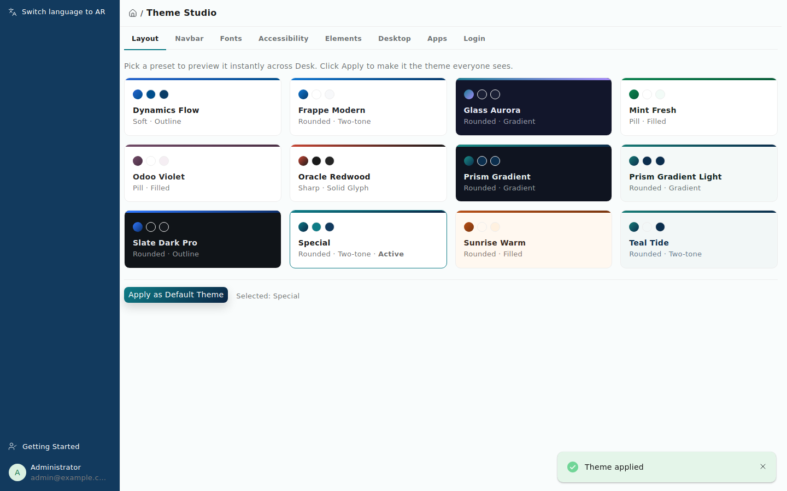
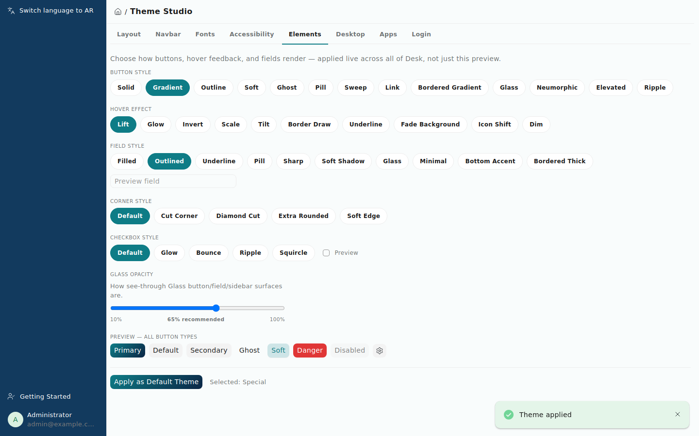
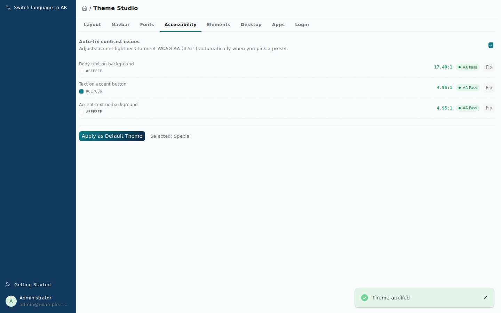
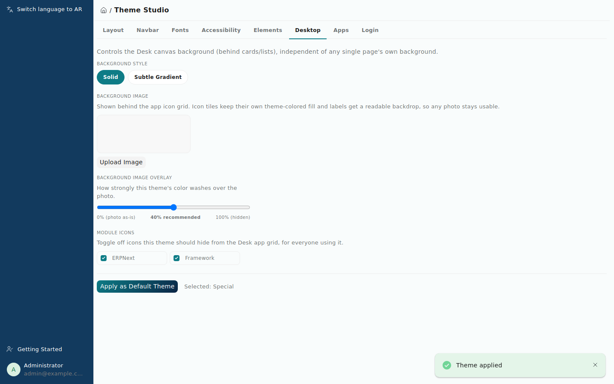
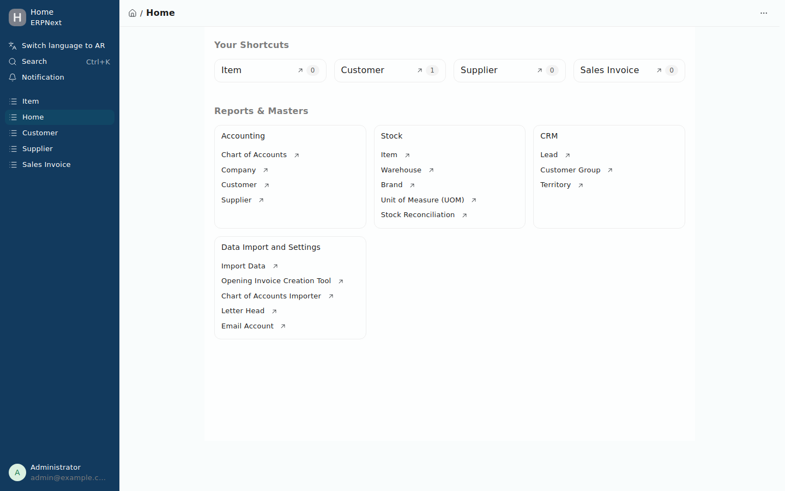
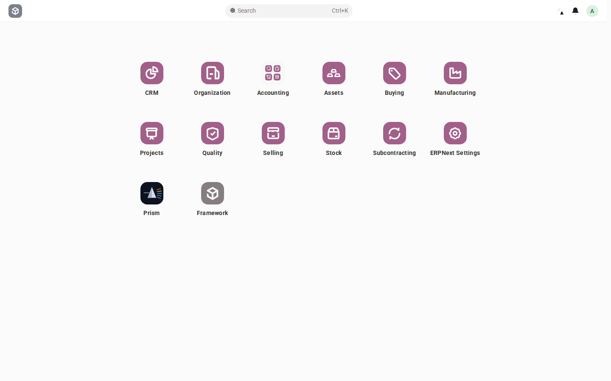
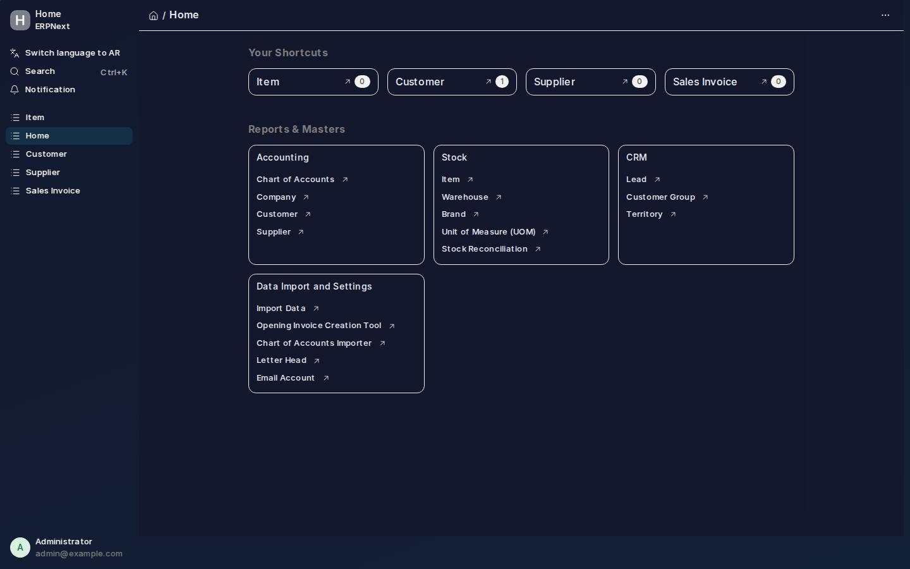

<div align="center">


# Prism

**A full visual theming layer for the Frappe Desk UI.**

[](#version-history)
[](https://github.com/frappe/frappe)
[](license.txt)

</div>

> ⚠️ **Beta software.** Prism is under active development and testing. Core theming (colors, fonts, elements, login) has been exercised heavily across light/dark themes and is stable; it is still being hardened against edge cases in native Desk components. See [Version History](#version-history) for what's changed release to release, and [Known Issues](#known-issues) for current limitations. Feedback and bug reports are very welcome.

## What is Prism?

Prism is a standalone Frappe app that lets you re-skin the entire Desk UI — colors, field shapes, fonts, icon styles, sidebar treatment, desktop backgrounds, per-app accents, and the login flow — **without touching core Frappe or ERPNext code**. It's built as a proper theming layer, not a CSS override hack: pick or build a theme in **Theme Studio**, and it applies instantly across the whole Desk session. Uninstall it and Desk returns exactly to its original appearance, with zero residue.

### Who it's for

- **Frappe/ERPNext administrators** who want their instance to look distinct — matching a company brand, a client's identity, or just a preference for dark mode done properly (not just inverted colors).
- **Implementation partners** who re-skin Frappe/ERPNext for different clients and want a reusable, no-code way to do it instead of hand-rolled CSS per project.
- **Anyone tired of the same default blue Frappe look** who wants a genuinely polished alternative — 12+ presets are included as a starting point, and every color/shape/style is editable live.

Prism does **not** touch business logic, doctypes' core fields, permissions, or any transactional behavior — it is purely presentational.

## Screenshots

**Theme Studio — Layout tab**, picking from the built-in preset gallery:



**Elements tab** — button/hover/field styles, corner treatments, checkbox styles, and a live Glass-opacity slider with a marked recommended value:



**Accessibility tab** — live WCAG AA contrast ratios with one-click auto-fix:



**Desktop tab** — background image behind the app icon grid with an overlay-opacity control, plus per-theme module icon visibility:



**Desk Home** themed end-to-end — sidebar, navbar, cards, shortcuts:



**Module icons recolored to match the active theme** (Odoo Violet shown — icons hue/saturation-matched to the preset's actual accent, not just rotated):



**A full dark theme** (Glass Aurora) applied across Desk — sidebar, navbar, cards, all auto-contrast-corrected:



**Login page** themed independent of Desk — this is the "Full Gradient" login layout, one of five selectable structural styles:


## Features

### Theming engine
- **12 built-in presets** spanning light, dark, and gradient styles (Frappe Modern, Dynamics Flow, Odoo Violet, Oracle Redwood, Slate Dark Pro, Mint Fresh, Sunrise Warm, Teal Tide, Prism Gradient, Prism Gradient Light, Special, and more)
- **Automatic contrast correction** — text/icon color on the navbar, sidebar, and buttons is computed at runtime from each surface's actual color (WCAG relative luminance), so a dark sidebar always gets light text and vice versa
- **Built-in accessibility checker** — live WCAG AA contrast ratios for body text, button text, and accent-on-background, each with a one-click auto-fix that nudges the color until it passes 4.5:1
- **Gradient accents** — any preset can define a two-color gradient for buttons, highlights, and module icon recoloring (icons blend both stops instead of skewing to one)
- Module/app icons are hue- and saturation-matched to the active theme's actual accent color at runtime, not just tinted — so a muted preset produces muted icons instead of neon ones

### Theme Studio (`/app/theme-studio`)
A live settings page, organized into tabs, with instant on-page preview and one-click Apply:
- **Layout** — preset gallery
- **Navbar** — navbar color, sidebar color (with reset-to-default), sidebar menu style (Theme Color / Dark / Light / Transparent / **Glass**)
- **Fonts** — 24+ curated font families
- **Accessibility** — the contrast checker above
- **Elements** — 13 button styles, 10 hover effects, 10 field styles, 5 corner styles (including clip-path bevels), 5 checkbox styles, and a Glass-opacity slider
- **Desktop** — canvas background style, an optional background image behind the app icon grid (with its own overlay-opacity control and a recommended-value marker), and per-theme module icon visibility toggles
- **Apps** — give specific installed apps (ERPNext, HRMS, ...) their own accent/navbar/sidebar colors, swapped in automatically as you navigate between apps
- **Login** — pick the login page's structural layout independent of its colors: Centered Card, Split Screen, Minimal, Glass Floating, or Full Gradient

### Access & assignment
- **Prism Manager** role gates all access (Theme Studio page, Theme Preset/Settings doctypes, APIs) — invisible to everyone else by default
- **Prism Theme Assignment** — bulk-assign a theme (with optional per-group style overrides) to a set of users, without touching what everyone else sees
- **Login & error-page theming** — the real Frappe auth pages (login, forgot password, email link, passwordless email login) and the generic error template (401 Session Expired, 403, 404, 500) pick up the active theme via a guest-safe endpoint, without any change to Frappe's actual authentication logic

### Architecture
- System-wide or per-user control via the `Theme Settings` singleton, `Theme Preset` doctype, and `Prism User Theme` cache — fully exportable/importable as fixtures
- Runtime engine applies colors/shapes as CSS custom properties (no page reload needed for preview); Desk-wide styles ship as a compiled CSS/JS bundle
- No custom fields on core doctypes — uninstalling leaves Desk exactly as it was

## Requirements

- **Frappe Framework v16** (`>=16.0.0-dev,<17.0.0-dev`)
- Compatible with **ERPNext v16** and any other Frappe v16 app — Prism only touches Desk's presentation layer, not business logic
- No additional system/apt dependencies

## Installation

```bash
cd $PATH_TO_YOUR_BENCH
bench get-app https://github.com/Omarhabeeb27/prism --branch version-16
bench --site $YOUR_SITE install-app prism
bench build --app prism
```

Then open **`/app/theme-studio`** (or find it under the **Prism** workspace in the Desk sidebar) to pick a theme. Access requires the **System Manager** or **Prism Manager** role.

## Uninstalling

```bash
bench --site $YOUR_SITE uninstall-app prism
```

Prism adds no custom fields to core doctypes, so uninstalling leaves Desk exactly as it was — no leftover CSS, JS, or DB residue.

## Known Issues

Beta software — this list is maintained honestly rather than hidden:

- A small number of native Desk surfaces can still show reduced contrast on dark themes in rare, specific contexts not yet covered. The large majority of Desk chrome — sidebar, navbar, buttons, fields, modals, list views, disabled fields, toasts, dropdowns/menus, the app-switcher, search bar, and login flow — has been explicitly audited and fixed.
- Native browser `<select>` dropdown option lists (e.g. Desk Settings → Desk Theme) are rendered by the OS/browser, not by page CSS, and can't be reliably restyled — this is a web platform limitation, not a Prism bug.
- Module icon recoloring is a hue/saturation-matched approximation (baked PNG/SVG assets can't be recolored directly), not pixel-perfect brand color replacement.

Found something else? Please open an issue with a screenshot and which theme/browser you were using — that's exactly what this beta period is for.

## Version History

| Version | Highlights |
|---|---|
| **0.2.0-beta** *(current)* | Per-app color overrides, Glass menu style + opacity control, Corner/Checkbox style pickers, Desktop background image with overlay control, Login Page Style (5 layouts), a comprehensive dark-theme contrast pass across modals/dropdowns/menus/lists/disabled fields/toasts, and several real rendering-bug fixes (icon color-matching across 4 distinct markup patterns, a Chromium compositing bug in the sort dropdown, login field alignment). |
| 0.1.x | Desktop icon visibility toggles, initial per-user theme assignment, expanded login/error-page theming, 12-preset gallery, WCAG accessibility checker. |
| 0.0.1 | Initial scaffold: Theme Preset/Settings doctypes, boot-time theme injection, first working preset set, Theme Studio page. |

This table is updated with every release — check back before upgrading to see what changed.

## Developer

| | |
|---|---|
| **Author & Maintainer** | Omar Habeeb |
| **Contact** | omarhabeeb242@gmail.com |
| **Repository** | [github.com/Omarhabeeb27/prism](https://github.com/Omarhabeeb27/prism) |

## Development

This app uses `pre-commit` for code formatting and linting:

```bash
cd apps/prism
pre-commit install
```

Configured tools: `ruff`, `eslint`, `prettier`, `pyupgrade`.

## License

MIT — Copyright © 2026 Omar Habeeb
