<div align="center">


# Prism

**A full visual theming layer for the Frappe Desk UI.**

[](CHANGELOG.md)
[](https://github.com/frappe/frappe)
[](license.txt)

</div>

> Developed and tested on **Frappe 16.54**. See [Compatibility](#compatibility) for other 16.x releases and [CHANGELOG.md](CHANGELOG.md) for what changed in each release.

## What is Prism?

Prism is a standalone Frappe app that lets you re-skin the entire Desk UI — colors, field shapes, fonts, icon styles, sidebar treatment, desktop backgrounds, per-app accents, and the login flow — **without touching core Frappe or ERPNext code**. It's built as a proper theming layer, not a CSS override hack: pick or build a theme in **Theme Studio**, and it applies instantly across the whole Desk session. Uninstall it and Desk returns exactly to its original appearance, with zero residue.

### Who it's for

- **Frappe/ERPNext administrators** who want their instance to look distinct — matching a company brand, a client's identity, or just a preference for dark mode done properly (not just inverted colors).
- **Implementation partners** who re-skin Frappe/ERPNext for different clients and want a reusable, no-code way to do it instead of hand-rolled CSS per project.
- **Anyone tired of the same default blue Frappe look** who wants a genuinely polished alternative — 16 presets are included as a starting point, and every color/shape/style is editable live.

Prism does **not** touch business logic, doctypes' core fields, permissions, or any transactional behavior — it is purely presentational.

## Screenshots

**Theme Studio**: a live preview of Desk beside real miniature themes, with the theme's colours as tiles you can click to edit.

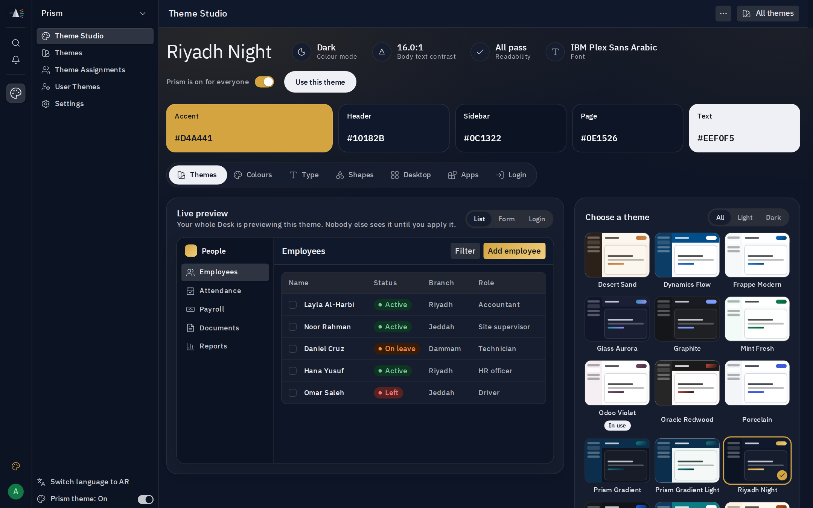

**Colours**: every colour with its hex value, the sidebar style, and live readability checks. The preview switches between list, form and login.

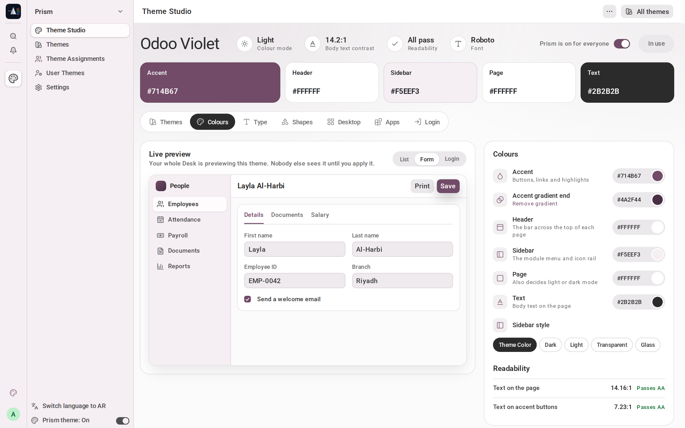

**Shapes and motion**: roundness, button styles, hover effects, fields, corners, checkboxes and icons.

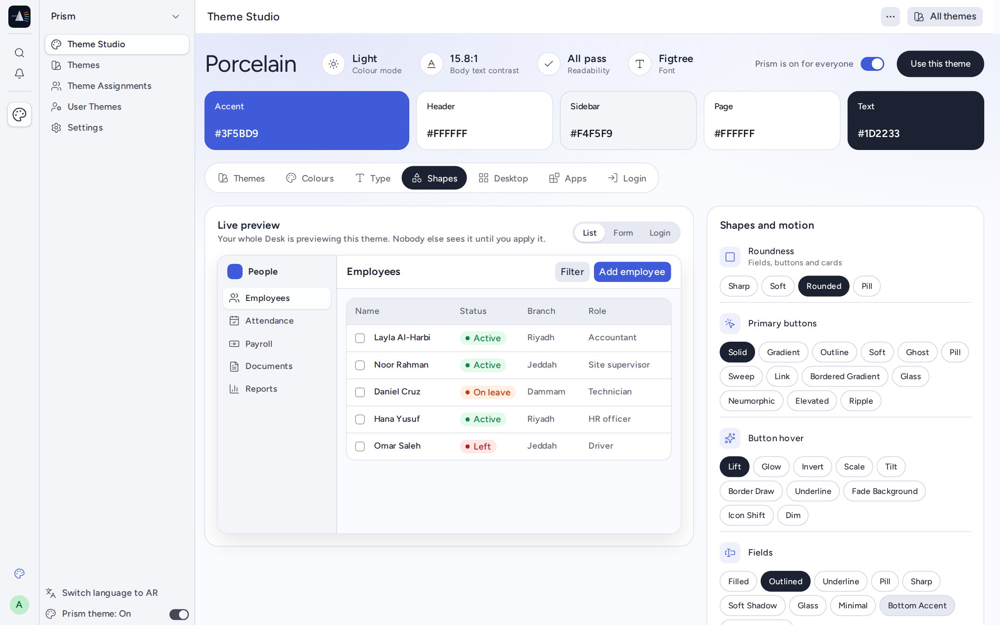

**Themes**: search and filter, contrast scores and usage, plus create, duplicate, export, import and reset.

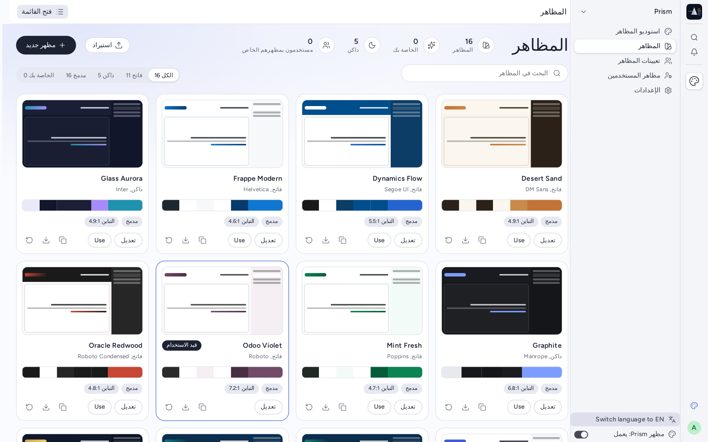

**Theme Assignments**: give a group of users a theme, with optional adjustments for that group.

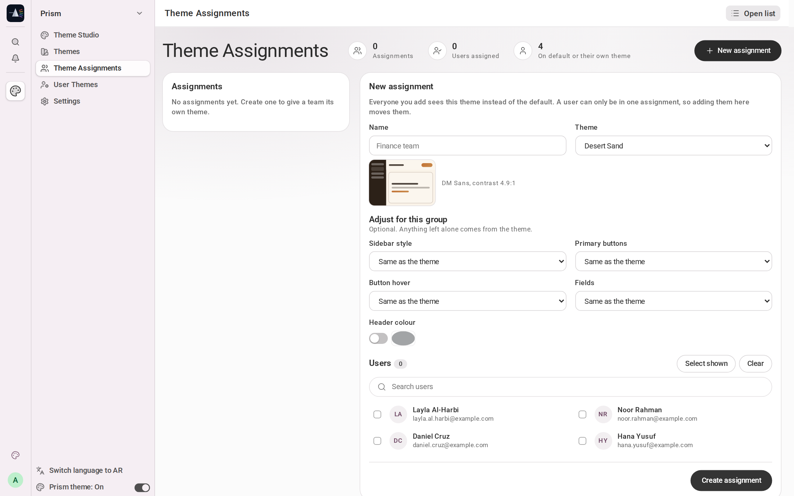

**User Themes**: which theme each person sees and why, and a way to change it. (Names shown are demo data.)

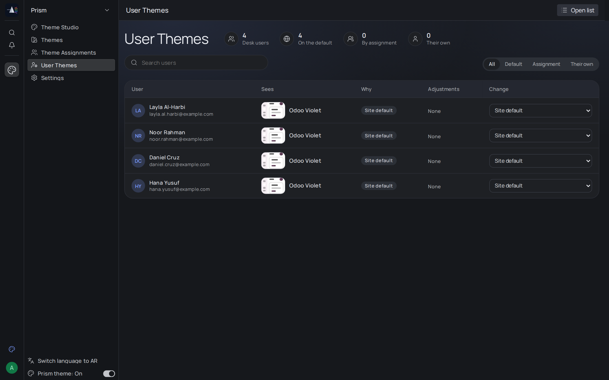

**Settings**: on/off, default theme, what users may do, a theme for dark mode, maintenance and install details.

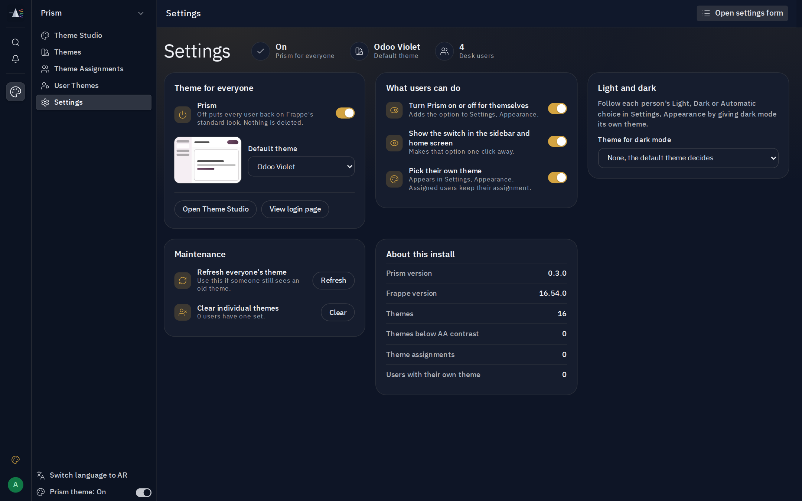

**Settings > Appearance**: every user can turn Prism on or off and pick a theme, inside Frappe's own dialog.

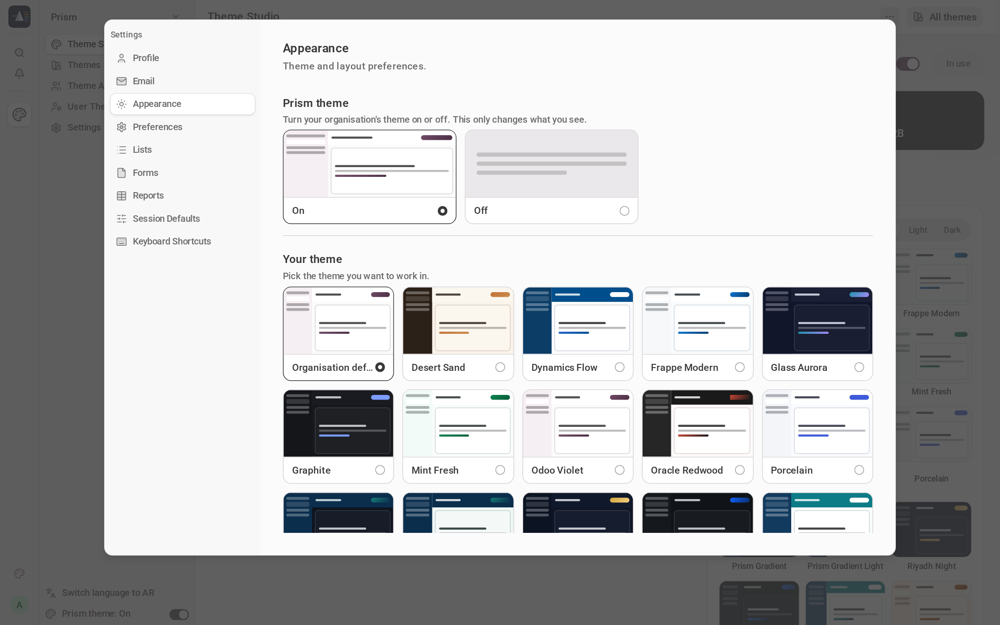

**Desk with a light theme and a dark theme**, using Frappe 16's sidebar and dock. The palette icon above the avatar is the on/off switch.

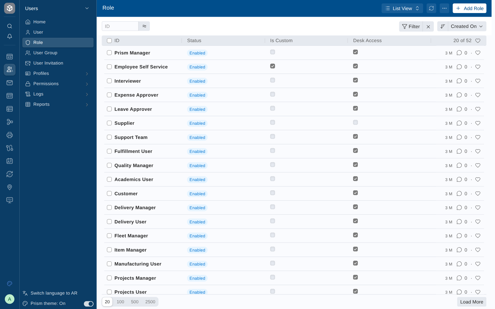

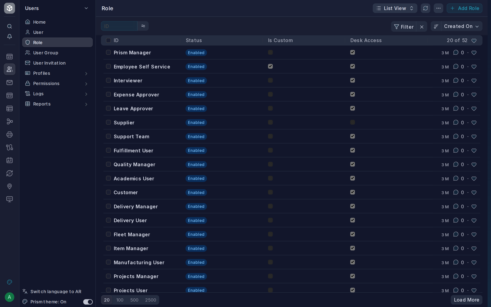

**Login page**: one of five layouts.

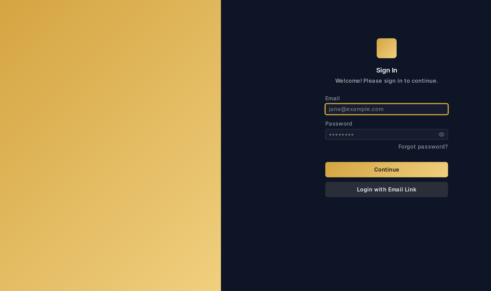

## Features

### Theming engine
- **16 built-in presets** spanning light, dark, and gradient styles (Frappe Modern, Dynamics Flow, Odoo Violet, Oracle Redwood, Slate Dark Pro, Mint Fresh, Sunrise Warm, Teal Tide, Prism Gradient, Prism Gradient Light, Special, and more)
- **Automatic contrast correction** — text/icon color on the header, sidebar, and buttons is computed at runtime from each surface's actual color (WCAG relative luminance), so a dark sidebar always gets light text and vice versa
- **Built-in accessibility checker** — live WCAG AA contrast ratios for body text, button text, and accent-on-background, each with a one-click auto-fix that nudges the color until it passes 4.5:1
- **Gradient accents** — any preset can define a two-color gradient for buttons, highlights, and module icon recoloring (icons blend both stops instead of skewing to one)
- Module/app icons are hue- and saturation-matched to the active theme's actual accent color at runtime, not just tinted — so a muted preset produces muted icons instead of neon ones

### Pages

All under the **Prism** sidebar, with a button to the plain list view where one applies.

- **Theme Studio**: live preview of Desk and the login page, colour tiles, readability checks, and Save, Discard and Undo.
- **Themes**: search, filter, contrast scores, usage, create from one brand colour, duplicate, export, import, reset.
- **Theme Assignments**: give a group of users a theme and style adjustments.
- **User Themes**: see what each user gets and why, and change it per user.
- **Settings**: on/off, default theme, what users may do, a theme for dark mode, maintenance, install details.

### For every user

- A **Prism on/off switch** above the avatar in the icon rail (pinned dock), in the sidebar, on the home screen, and in **Settings > Appearance**. It applies instantly and affects only that user.
- A personal theme choice in **Settings > Appearance**.

Administrators can turn each of these off in Prism's Settings.

### Access and architecture

- The **Prism Manager** role (or System Manager) gates all administration. The personal switch and theme choice are open to every logged-in user.
- Login and error pages follow the theme through a guest-safe endpoint, with no change to Frappe's authentication.
- A theme is applied as CSS custom properties, so previews need no reload. Dark themes use Frappe's own dark mode.
- No custom fields on core doctypes. With Prism off, its stylesheets match nothing.

## Requirements

Built and tested for **Frappe 16** and **ERPNext 16**.

- **Frappe Framework v16** (`>=16.0.0-dev,<17.0.0-dev`)
- **ERPNext v16** if installed alongside it (Prism works with or without ERPNext — it only touches Desk's presentation layer, not business logic, and is compatible with any other Frappe v16 app too)
- No additional system/apt dependencies

## Compatibility

| | |
|---|---|
| **Tested** | Frappe 16.54, ERPNext 16.53, HRMS 16.53 |
| **Declared range** | `>=16.0.0-dev,<17.0.0-dev` |
| **Other 16.x releases** | Prism includes fallbacks for earlier markup (`.navbar`, `--surface-menu-bar`) but has **not** been run on them. Please test before relying on it. |
| **Other apps** | Prism overrides other apps' sidebar text colours while a theme is on. Apps with heavily custom pages may need their own adjustments. |

## Installation

```bash
cd $PATH_TO_YOUR_BENCH
bench get-app https://github.com/Omarhabeeb27/prism --branch version-16
bench --site $YOUR_SITE install-app prism
bench build --app prism
```

Then open **`/app/theme-studio`** (or find it under the **Prism** workspace in the Desk sidebar) to pick a theme. Access requires the **System Manager** or **Prism Manager** role.

## Uninstalling

```bash
bench --site $YOUR_SITE uninstall-app prism
```

Prism adds no custom fields to core doctypes, so uninstalling leaves Desk exactly as it was — no leftover CSS, JS, or DB residue.

## Known issues

- Native browser `<select>` option lists are drawn by the browser and can't be fully themed.
- Module icon recolouring is a hue and saturation match, because the icons are fixed image files.
- While a theme is on it decides light or dark mode. To follow each person's choice, set a **Theme for dark mode** in Settings.
- A logo stored as a private file can't load before login. Prism shows an accent mark instead; make the file public to show your logo.

## Version history

See [CHANGELOG.md](CHANGELOG.md).

## Developer

| | |
|---|---|
| **Author & Maintainer** | Omar Habeeb |
| **Contact** | omarhabeeb242@gmail.com |
| **Repository** | [github.com/Omarhabeeb27/prism](https://github.com/Omarhabeeb27/prism) |

## Development

Tests: `bench --site <test-site> run-tests --app prism`


This app uses `pre-commit` for code formatting and linting:

```bash
cd apps/prism
pre-commit install
```

Configured tools: `ruff`, `eslint`, `prettier`, `pyupgrade`.

## License

MIT — Copyright © 2026 Omar Habeeb
